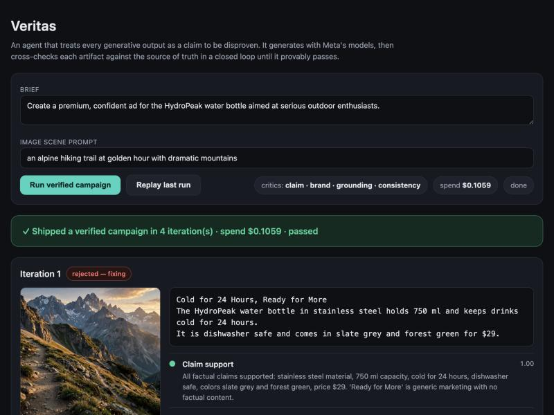

# Veritas

**An agent that treats every generative output as a claim to be disproven** — it
generates with Meta's models, then adversarially cross-checks each artifact
against its source of truth in a closed loop until it provably passes, refusing
to ship anything it cannot verify.

Built for the **Meta Global AI Developer Hackathon** on the Meta Model API
(Muse Spark, Muse Image, SAM 3.1).



## Why

Generative models are powerful but confidently wrong. Veritas is a framework
where **nothing ships unverified**: the model that *creates* an artifact is
never the only model that *judges* it, every check returns a machine-checkable
verdict, and every iteration is logged to an append-only audit trail.

Watch it catch its own mistakes — here SAM 3.1 finds no product in the first
render, and the cross-modal consistency critic rejects a bottle whose markings
imply the wrong capacity:


## How it works

```
brief + source of truth
        │
        ▼
   ┌─ Generator ─┐        Muse Spark (copy) · Muse Image (image)
   │             │
   ▼             │
 Verifier court ─┘        four independent critics, each a structured verdict
   │                      {pass, score, reason, fix_hint}
   ▼
 all pass? ── yes ──▶ ship (with audit trail)
   │
   no ──▶ Fixer repairs only the faulty artifact ──▶ loop back
```

### The verifier court

| Critic | Judges | Powered by |
|--------|--------|-----------|
| `claim_support` | every factual claim in the copy is backed by the product facts | Muse Spark |
| `brand` | tone, length, banned words / unverified superlatives | Muse Spark |
| `grounding` | the product is actually present and prominent in the image | SAM 3.1 |
| `consistency` | the image does not contradict the copy (product, colour, scene) | Muse Spark vision |

A failing check is routed to the artifact that owns it, so the Fixer
regenerates **only** the copy or **only** the image — never blindly both.

### Design principles

1. **Nothing ships unverified** — every artifact has a machine-checkable pass/fail.
2. **Separation of powers** — generators and critics are independent model calls.
3. **Structured verdicts, not prose** — critics emit strict JSON (`Verdict`).
4. **Everything is logged** — the audit ledger is the guarantee and the proof.
5. **Fail closed, bounded** — hard iteration + spend limits; refuses rather than shipping garbage.

## Repo layout

| File | Role |
|------|------|
| `veritas/meta_client.py` | Meta Model API client (Responses + Images) + spend ledger |
| `veritas/contracts.py`   | The `Verdict` contract + robust JSON parsing |
| `veritas/sam.py`         | SAM 3.1 segmentation output parser (boxes + prominence) |
| `veritas/generators.py`  | Copy and image generators |
| `veritas/critics.py`     | The four independent critics |
| `veritas/fixer.py`       | Turns failing verdicts into fix instructions |
| `veritas/orchestrator.py`| The loops (text / image / campaign), budget guard, audit ledger |
| `app.py`                 | Live web UI streaming the loop over SSE (+ replay mode) |
| `run_demo*.py`           | CLI demos: text, grounded image, full campaign |

## Quick start

```bash
pip install -r requirements.txt
cp .env.example .env            # put your Meta Model API key in .env
set -a; source .env; set +a
```

Command-line demos:

```bash
python run_demo.py            # text claim-support loop
python run_demo_image.py      # grounded-visual loop (Muse Image + SAM 3.1)
python run_demo_campaign.py   # full campaign: copy + image, 4 critics
```

Live UI (what the screenshots show):

```bash
python app.py                 # open http://127.0.0.1:5050
```

The UI has a **live** mode (runs a real campaign on the Meta Model API) and a
**replay** mode (replays the most recent saved run from `runs/` with no API
spend — handy for demos).

## Meta Model API integration

- Base URL `https://api.meta.ai/v1`, auth `Authorization: Bearer $MODEL_API_KEY`
- Text / grounding / agentic → `POST /responses`; images → `POST /images/generations`
- Models: `muse-spark-1.3` (copy, critics, vision), `muse-image-1.0` (image),
  `sam-3.1` (grounded verification)
- The client keeps a live USD spend ledger and the orchestrator enforces a hard
  per-run budget.

## Status

- [x] Meta Model API client with live spend tracking
- [x] Verdict contract + closed loop + audit ledger
- [x] Text claim-support verification loop
- [x] Muse Image generation + SAM 3.1 grounding critic
- [x] Brand + cross-modal consistency critics (unified campaign loop)
- [x] Live web UI showing the catch-and-fix (live + replay modes)
- [ ] 3-minute demo video

## License

MIT — see [LICENSE](LICENSE).
