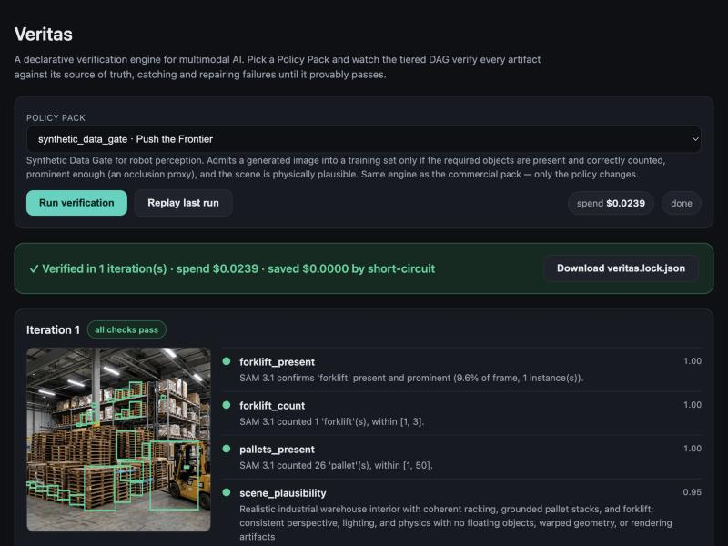
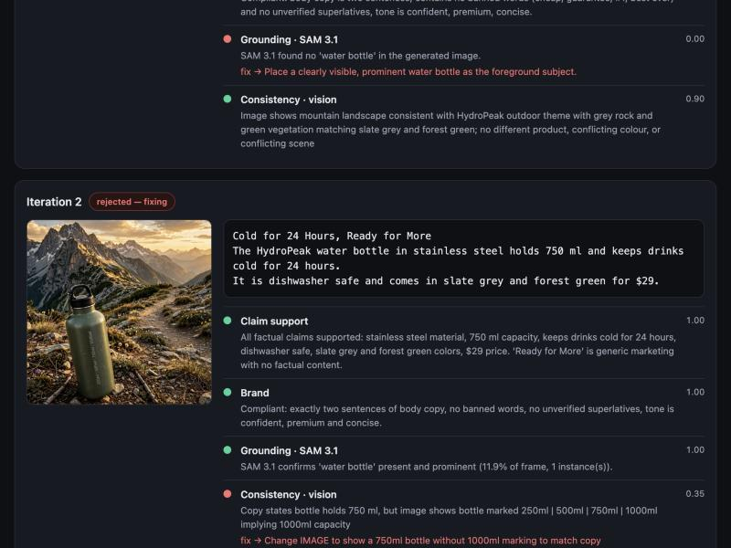
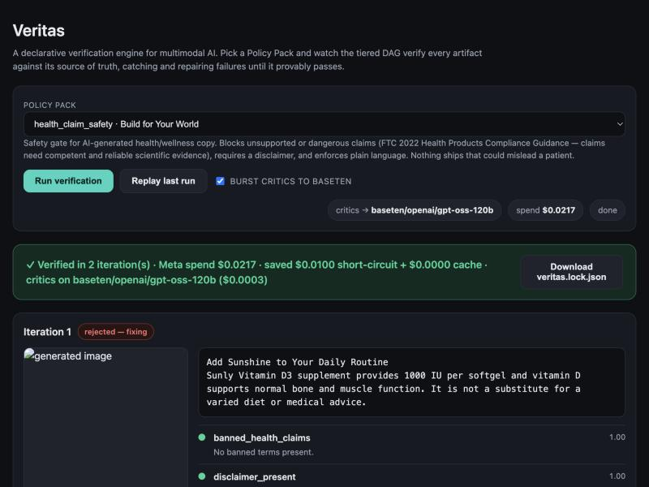

# Veritas

**CI/CD for multimodal AI.** Veritas is a declarative verification engine: it
generates with Meta's models, then cross-checks every artifact against a
*policy* — a hot-swappable contract of tiered checks — in a closed loop until it
provably passes, refusing to ship anything it cannot verify. Each run ends in a
cryptographic receipt.

Built for the **Meta Global AI Developer Hackathon** on the Meta Model API
(Muse Spark, Muse Image, SAM 3.1).



## The idea

Generative models are powerful but confidently wrong. Veritas treats every
output as a *claim to be disproven*. The same engine runs any **Policy Pack**, so
a whole domain is just a YAML file — five ship today:

| Policy Pack | Theme | Gates against | Grounded in |
|---|---|---|---|
| Commercial Brand Guard | Build for Your World | false ad claims, product misrepresentation | FTC advertising substantiation |
| Accessibility Gate | Build for Your World | unreadable copy, illegible / mismatched creative | WCAG 2.2 (SC 1.1.1, 1.4.3), CDC plain-language |
| Health Claim Safety | Build for Your World | dangerous / unsupported medical claims | FTC 2022 Health Products Guidance |
| Synthetic Data Gate | Push the Frontier | bad robot-perception training data | object presence / count / plausibility |
| Trust & Safety Gate | Push the Frontier | AI misinformation — out-of-context image↔caption pairs | complements C2PA provenance |

Nothing changes between them but the policy. (Real catches from live runs: a
bottle marked "1000ml" against 750ml copy; health copy that failed plain-language
and got auto-simplified; an image whose sign read "Wednesdays 4pm" while the copy
said "Saturdays 10–12".)

## Architecture

```
policy pack (YAML)  +  source of truth
        │
        ▼
   generate (Muse Spark / Muse Image)
        │
        ▼
  Tier 1  ── cheap deterministic + SAM 3.1 spatial gate ──┐  fail → short-circuit
        │ pass                                            │  (skip Tier 2, save credits)
        ▼                                                 │
  Tier 2  ── semantic court (fact / brand / vision) ──────┘
        │
   all pass? ── yes ─▶ ship + cryptographic receipt (veritas.lock.json)
        │
        no ─▶ route each failure to the artifact that owns it ─▶ fix only that ─▶ loop
```

- **Async tiered DAG** (`veritas/engine.py`): a cheap Tier-1 failure short-circuits
  the expensive semantic court — on a real run this saved **$0.03–$0.06 per run**.
- **Separation of powers**: generators and critics are independent model calls;
  deterministic checks gate the LLM ones (mitigates LLM-as-a-judge bias).
- **Fix routing**: a failing check is routed to the copy *or* the image, so the
  Fixer regenerates only what broke.
- **Fail closed**: hard iteration + spend budgets; it refuses rather than ships.

### Check types

| Type | Tier | Evidence | Model |
|------|------|----------|-------|
| `banned_terms`, `max_sentences` | 1 | deterministic (regex) | — |
| `reading_level` | 1 | Flesch Reading Ease ≥ target | — |
| `required_terms` | 1 | required text (e.g. a disclaimer) | — |
| `grounding` | 1 | object present & prominent | SAM 3.1 |
| `object_count` | 1 | instance count in range | SAM 3.1 |
| `claim_support` | 2 | every claim backed by facts | Muse Spark |
| `brand_tone` | 2 | tone / banned-claim compliance | Muse Spark |
| `consistency` | 2 | image ↔ copy agreement | Muse Spark vision |
| `text_legibility` | 2 | in-image text is readable (WCAG) | Muse Spark vision |
| `scene_plausibility` | 2 | physically plausible scene | Muse Spark vision |

Grounding failures caught in practice: a missing product, a bottle marked
"1000ml" against 750ml copy, a plastic bottle against stainless-steel copy —
all auto-repaired. SAM 3.1 boxes are drawn over the image in the UI, red when
rejected and green when verified:



## Quick start

```bash
pip install -r requirements.txt
cp .env.example .env            # add your Meta Model API key
set -a; source .env; set +a
```

Run a policy from the command line (writes a receipt):

```bash
python cli.py policies/commercial_brand_guard.yaml
python cli.py policies/accessibility_gate.yaml
python cli.py policies/health_claim_safety.yaml
python cli.py policies/synthetic_data_gate.yaml
python cli.py policies/trust_and_safety_gate.yaml
```

Live UI with a policy switcher, SAM box overlays, and a downloadable receipt:

```bash
python app.py                   # http://127.0.0.1:5050
```

Tests (offline, no API key needed):

```bash
pytest -q
```

## The receipt (`veritas.lock.json`)

Every run emits a tamper-evident manifest — SHA-256 hashes of the shipped
assets, the policy and checks that certified them, per-critic final scores, and
the economics (credits spent vs. saved by short-circuiting). See
[`docs/sample.veritas.lock.json`](docs/sample.veritas.lock.json).

## Inference partners (hybrid routing)

Veritas keeps the Meta Model API as its primary engine (Muse Spark, Muse Image,
SAM 3.1) and can **burst the text-only critics to an inference partner** running
open-weights models — Baseten, Fireworks, or Modal (any OpenAI-compatible
endpoint; only the base URL and model slug change). Generation, SAM grounding,
and the vision critics stay on Meta.

```bash
python cli.py policies/commercial_brand_guard.yaml --partner
```

Because the budget guard tracks Meta spend, offloading critics to the partner
*reduces* Meta credit usage. A measured run routing `claim_support` + `brand_tone`
to Baseten `openai/gpt-oss-120b` cut `muse-spark` spend from ~$0.043 to ~$0.018,
and the receipt records the split (`partner_spend_usd`, `critics_routed_to`, and
a per-model breakdown). The UI has a one-click **"burst critics to Baseten"**
toggle, so the routing is visible live:



## Repo layout

| Path | Role |
|------|------|
| `veritas/policy.py` | policy pack types + YAML loader + validation |
| `veritas/providers.py` | OpenAI-compatible partner adapter (Baseten/Fireworks/Modal) |
| `veritas/engine.py` | async tiered DAG, short-circuit, fix routing, budget |
| `veritas/checks.py` | check registry (deterministic + LLM/SAM), tiered |
| `veritas/critics.py` | the independent critics |
| `veritas/receipt.py` | cryptographic audit receipt |
| `veritas/meta_client.py` | Meta Model API client + thread-safe spend ledger |
| `policies/*.yaml` | the Policy Packs |
| `app.py` / `cli.py` | live UI / command line |
| `tests/` | offline test suite (pytest), run in CI |

## Grounded in the literature

Self-Refine (Madaan et al., 2023), Reflexion (Shinn et al., 2023),
Chain-of-Verification (Dhuliawala et al., 2023), FActScore (Min et al., 2023),
Constitutional AI (Bai et al., 2022), LLM-as-a-Judge (Zheng et al., 2023), and
Segment Anything (Kirillov et al., 2023).

## License

MIT — see [LICENSE](LICENSE).
